<div align="center">


<a href="https://git.io/typing-svg">
  
</a>

<br/>

### ⟡ Live telemetry ⟡

[](https://github.com/AbdulWajid768/inmailer/stargazers)
[](https://github.com/AbdulWajid768/inmailer/network/members)
[](https://pypi.org/project/inmailer/)
[](https://pypi.org/project/inmailer/)
[](LICENSE)

[](https://github.com/AbdulWajid768/inmailer/commits/main)
[](https://github.com/AbdulWajid768/inmailer/graphs/commit-activity)
[](https://github.com/AbdulWajid768/inmailer)

<br/>




<br/><br/>

[📦 Install](#-install) · [⚡ Usage](#-usage) · [🔬 Engine](#-engine)


</div>

---

## ◈ Transmission

Email clients **amputate** your `<style>` blocks. **Inmailer** rewrites HTML for the inbox era: parse document CSS, **inline** what survives (following the real CSS cascade — specificity and `!important` win), and **rehydrate** `@media`, `@font-face`, and pseudo-rules into a single `<style>` in `<head>`.

```text
   HTML + <style>  ──►  cssutils parse  ──►  rule classifier
                              │                    │
                              │         ┌──────────┴──────────┐
                              │         ▼                     ▼
                              │    inlineable            non-inlineable
                              │    (lxml match)          (re-insert <style>)
                              ▼
                        inbox-ready markup
```

---

## ◈ Install

```bash
pip install inmailer
```

Requires **Python 3.8+**.

```bash
git clone https://github.com/AbdulWajid768/inmailer.git
cd inmailer && pip install -e .[test]
```

**Stack:** `lxml` · `cssutils` · `cssselect`

---

## ◈ Usage

```python
from inmailer import inline_css

html_content = """
<html>
  <head>
    <style>
      h1 { color: red; }
      #title { color: green; }            /* more specific -> wins */
      a:hover { text-decoration: underline; }  /* kept in <style> */
      @media (max-width: 600px) { .wrap { padding: 8px; } }
    </style>
  </head>
  <body><h1 id="title">Hello, inbox</h1></body>
</html>
"""

print(inline_css(html_content))
```

### Options

```python
inline_css(
    html_content,
    extra_css="p { font-size: 14px; }",  # inline CSS from a separate source
    remove_classes=True,                 # strip class="" after inlining
    keep_style_tags=False,               # also keep the original <style> block
    pretty_print=True,                   # set False for compact output
)
```

### Work with files

```python
from inmailer import inline_css_file

inline_css_file("newsletter.html", "newsletter.inlined.html", remove_classes=True)
```

### Command line

```bash
inmailer input.html -o output.html --remove-classes
cat input.html | inmailer --compact > output.html
```

---

## ◈ Engine

| Capability | Status |
| --- | --- |
| Inline element/class/id rules | ✓ |
| Specificity-aware cascade | ✓ |
| `!important` merge logic | ✓ |
| Preserve existing inline styles | ✓ |
| Preserve `@media` / `@font-face` | ✓ |
| Preserve `:hover` / pseudo | ✓ |
| Inline extra CSS (`extra_css`) | ✓ |
| CLI + file helper | ✓ |
| Malformed CSS → skip gracefully | ✓ |

---

## ◈ Contributing

Fork → branch → `pip install -e .[test]` → `pytest` → PR. Keep changes surgical in `inmailer/core.py`.

---

<div align="center">

<a href="https://star-history.com/#AbdulWajid768/inmailer&Date">
  <picture>
    <source media="(prefers-color-scheme: dark)" srcset="https://api.star-history.com/svg?repos=AbdulWajid768/inmailer&type=Date&theme=dark"/>
    
  </picture>
</a>

<br/><br/>

**[Abdul Wajid](https://github.com/AbdulWajid768)** · [abdul45.wajid@gmail.com](mailto:abdul45.wajid@gmail.com)

[](https://github.com/AbdulWajid768)


<sub>Style in the lab · Render in the inbox.</sub>

</div>
